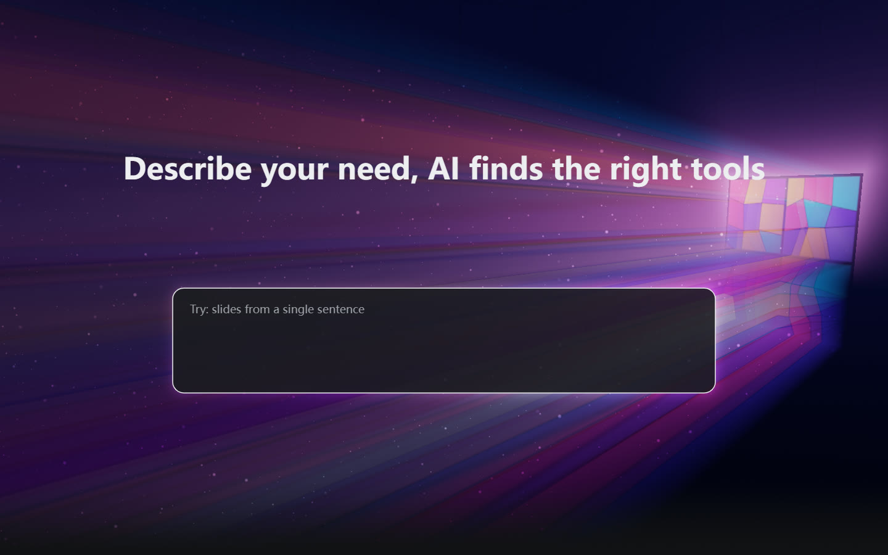
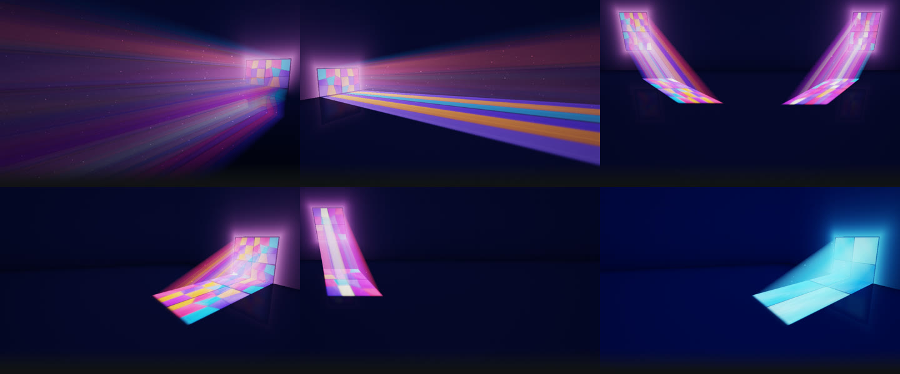
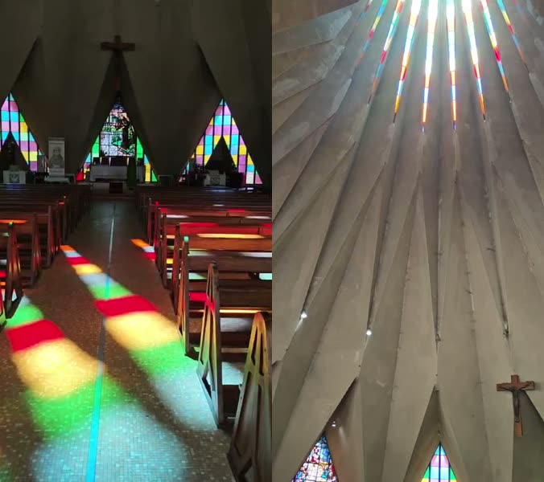

<div align="center">

# Polanaluz

**Stained-glass light for your hero section.**<br />
Windows-wallpaper-style beams of light through stained glass, rendered live in the browser.<br />
~18 KB gzipped · zero dependencies · WebGL2 · dark & light themes

[**Live demo**](https://nwnuyhs.github.io/polanaluz/) · [Component example](https://nwnuyhs.github.io/polanaluz/examples/component.html) · [中文](README.zh-CN.md)

Made by the team behind [**aiknow.cc**](https://www.aiknow.cc/?ref=polanaluz-github), the AI tools search engine,<br />
and [**hunt.now**](https://www.hunt.now/?ref=polanaluz-github), a search engine for design resources.



</div>

## Why

Most animated hero backgrounds are gradients or blobs. Polanaluz renders an actual scene: a quiet room, a stained-glass window, and light that crosses the page toward your content. The composition is built around one element, usually the search box. Beams converge on it, its edges catch the colored light, and the rest of the page stays readable.


## Features

- **Alive, not a video.** The light direction drifts over tens of seconds, the glow breathes like passing clouds, and fine dust floats inside the beams. Nothing loops.
- **Built around your content.** Point it at an element (`focus="#search"`). The beams aim for it and its border picks up the color of the light passing by.
- **Stained-glass Windows panes.** Clean 2×2 panes like the Windows 10 / 11 wallpapers, optionally filled with stained-glass pieces. Beams are solved analytically per pane, so the gaps between panes stay razor sharp. There is no ray-marching noise.
- **Flexible light.** Parallel sunlight or divergent beams, windows on the back wall or either side wall, light that lands on the floor or sweeps across the page without touching it.
- **Dark and light themes.** Each style has both. `theme="auto"` follows `<html data-mode>`, `data-theme`, `.dark` or the system setting, with a soft crossfade.
- **Well behaved.** A static WebP poster shows on first paint and fades into the live render. Animation runs at 30 fps, pauses off-screen and in background tabs, and stops for `prefers-reduced-motion`. On our test machine a 1080p frame takes about 4 ms at the default half resolution; slower GPUs will need more.
- **A generator to design it.** Tweak every parameter, share the look by URL, and export a ready-to-use bundle.

## Styles



| Style | Look |
|---|---|
| `stained-rays-rl` (default) | Window on the right wall; beams fan out to the left across the whole page |
| `stained-rays-lr` | Window on the left wall; beams spread right and paint panes on the floor |
| `stained-pair` | Two windows beside the headline; beams converge on the search box |
| `stained-side` | Side-wall window; crisp beams with pane gaps cross the room |
| `stained-floor` | Back-wall window; light falls on the floor (Windows 11 vibe) |
| `microsoft-classic` | Clean blue 2×2 panes, a tribute to the Windows wallpaper |

## Quick start

### 1. Design a look

Open the [generator](https://nwnuyhs.github.io/polanaluz/). Pick a style, tweak it in both dark and light, then choose **Export → Bundle**. You get three files:

```
polanaluz.json         settings for dark + light
polanaluz-dark.webp    static poster (dark)
polanaluz-light.webp   static poster (light)
```

You can also skip this step and use a built-in style with `preset="…"`.

### 2. Drop it into your page

```html
<section class="hero">
  <polana-luz
    config-url="/polanaluz.json"
    poster-dark="/polanaluz-dark.webp"
    poster-light="/polanaluz-light.webp"
    focus="#search-box"
  ></polana-luz>
  <h1>…</h1>
  <div id="search-box">…</div>
</section>

<script src="/polanaluz.min.js"></script>

<style>
  .hero { position: relative; }
  .hero polana-luz { position: absolute; inset: 0; z-index: 0; pointer-events: none; }
  .hero > :not(polana-luz) { position: relative; z-index: 1; }
</style>
```

`polanaluz.min.js` is in `dist/lib/` after `npm run build`. It is also served with the demo at `https://nwnuyhs.github.io/polanaluz/lib/polanaluz.min.js`, which is fine for quick tests. Self-host it for production.

> If the background sits behind the whole page, put the page background color on `html`, not `body`. A `body` background paints over elements with a negative `z-index`.

### Attributes

| Attribute | Default | |
|---|---|---|
| `preset` | `stained-rays-rl` | Built-in style id (see the table above) |
| `config-url` | – | JSON exported from the generator; takes precedence over `preset` |
| `theme` | `auto` | `auto`, `dark` or `light` |
| `focus` | – | CSS selector of the element the light is composed around. Waits for it if it is rendered later |
| `mode` | `dynamic` | `static` shows only the poster and never loads WebGL |
| `poster-dark` / `poster-light` | – | Static images for first paint, static mode and browsers without WebGL2 |
| `render-scale` | `0.5` | Render resolution relative to CSS pixels. The light is soft, so 0.5 looks the same |

From JavaScript: `el.config = { dark, light }` sets the settings directly, and `el.instance` is the engine, so `el.instance.pause()` and `el.instance.play()` are available.

## React / Next.js

The library is SSR-safe: importing it on the server does nothing, and it registers `<polana-luz>` once it runs in the browser. Copy `dist/lib/polanaluz.esm.js` (and `dist/lib/types/` if you want types) into your project, then load it in a client component:

```tsx
"use client";
import { useEffect } from "react";

export function HeroLight() {
  useEffect(() => {
    import("@/lib/vendor/polanaluz.esm.js"); // registers <polana-luz>
  }, []);
  return (
    <polana-luz
      className="absolute inset-0 -z-10 pointer-events-none"
      config-url="/polanaluz/polanaluz.json"
      poster-dark="/polanaluz/polanaluz-dark.webp"
      poster-light="/polanaluz/polanaluz-light.webp"
      focus="#hero-search"
    />
  );
}
```

TypeScript needs to know about the tag once:

```ts
// polanaluz.d.ts
import type { DetailedHTMLProps, HTMLAttributes } from "react";
declare module "react" {
  namespace JSX {
    interface IntrinsicElements {
      "polana-luz": DetailedHTMLProps<HTMLAttributes<HTMLElement>, HTMLElement> & Record<string, unknown>;
    }
  }
}
```

## JavaScript API

```js
import { Polanaluz, getStyle } from "./polanaluz.esm.js";

const style = getStyle("stained-rays-rl");
const light = new Polanaluz(canvas, style.dark, { renderScale: 0.5 });

light.trackFocus(document.querySelector("#search")); // compose around an element
light.set({ sun: { elevation: 6 }, scene: { dust: 0.8 } }); // partial update
light.setConfig(style.light);                               // full replace
light.pause(); light.play();
const webp = await light.toBlob(1920, 1080, "image/webp");  // render a still
light.destroy();
```

`Polanaluz.supported()` tells you whether the browser has WebGL2. Every setting is plain JSON; see [`src/core/types.ts`](src/core/types.ts) for the full, commented list.

## How it works

Each pixel casts a ray into a minimal room: a back wall, an optional floor and side wall. The surface it hits gathers light by tracing toward the light source, through the window plane, into a procedurally painted glass texture, with a soft penumbra that grows with distance. The beams in the air are not ray-marched. For each pane, the span of the view ray that lies inside the light prism is solved in closed form, linear for sunlight and projective for divergent beams. That is why the beam edges and pane gaps are crisp and noise-free at a fraction of the cost. On top of that come ACES tone mapping, a glossy floor that reflects the windows, faint wall panels and floating dust.

## Inspiration

The name comes from the **Igreja de Santo António da Polana** in Maputo, Mozambique (Nuno Craveiro Lopes, 1962). Light falls through thin slits of colored glass between its folded concrete petals and lays long, segmented beams of red, yellow and green across the floor. Polanaluz = *Polana* + *luz*, Portuguese for light. The look was later refined with the Windows 10 / 11 wallpapers in mind.



## Development

```bash
npm install
npm run dev     # generator at http://localhost:5190
npm run build   # type check + generator (dist/studio) + library (dist/lib, dist/lib/types)
npm run deploy  # build the demo and publish it to the gh-pages branch
```

The generator has a Chinese / English switch. Its state lives in the URL hash, so a link reproduces a look exactly.

## Who made this

Polanaluz is built and used by:

- [**aiknow.cc**](https://www.aiknow.cc/?ref=polanaluz-github): an AI tools search engine. Describe what you need in plain words and get the right AI assistants, models, agents and open-source projects.
- [**hunt.now**](https://www.hunt.now/?ref=polanaluz-github): a search engine for design resources.

If Polanaluz helps you, a ⭐ on GitHub or a visit to either site is the best thank-you.

## License

[MIT](LICENSE). Windows is a trademark of Microsoft. This project is not affiliated with or endorsed by Microsoft.
